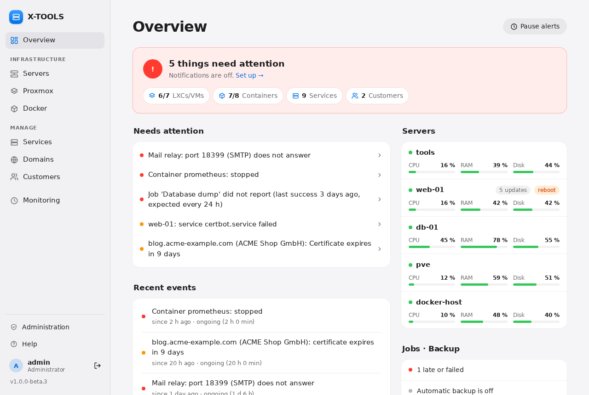
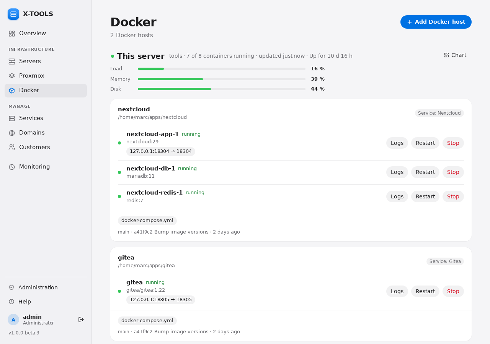
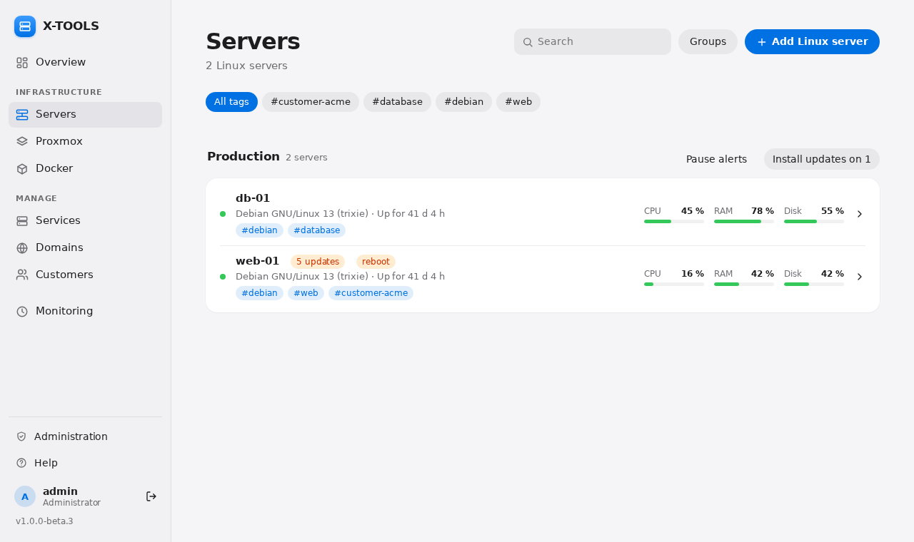
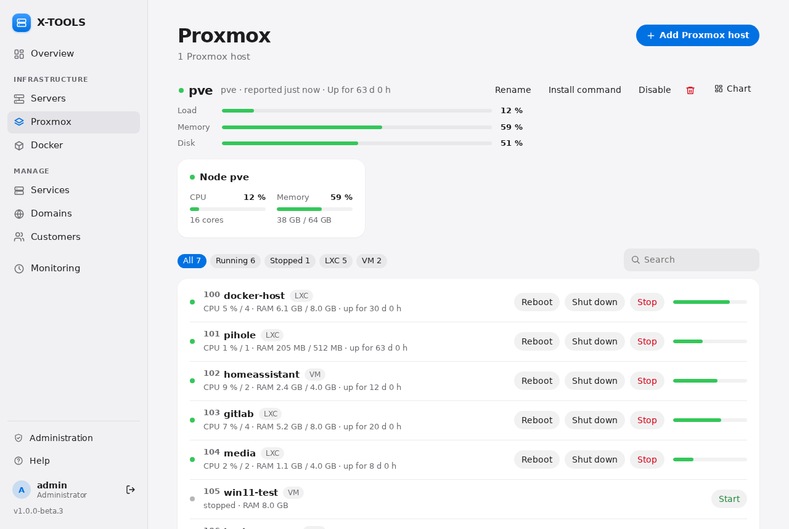
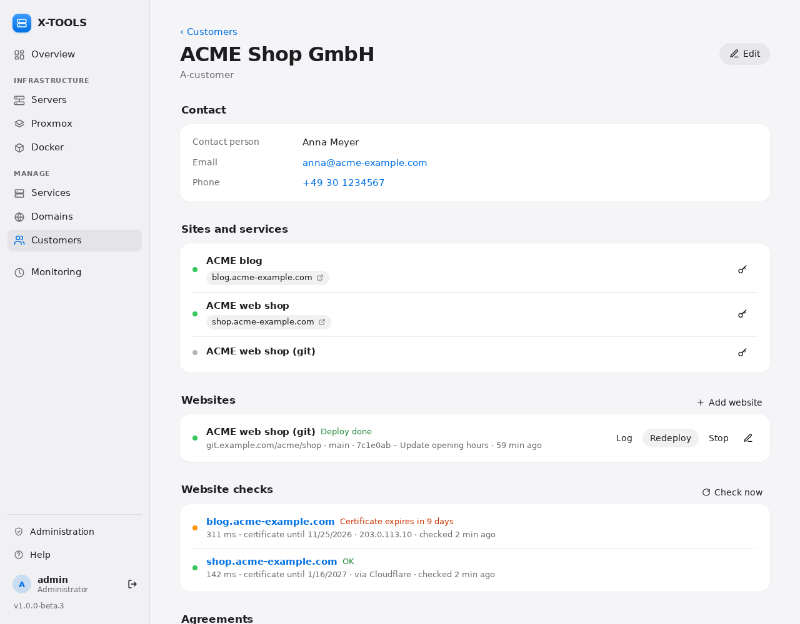
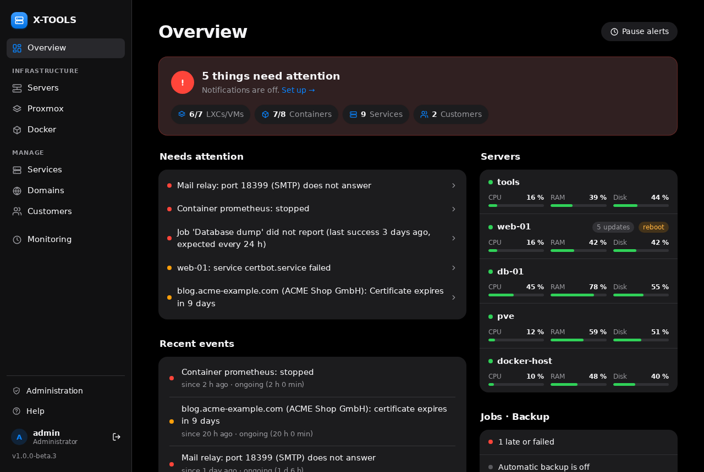
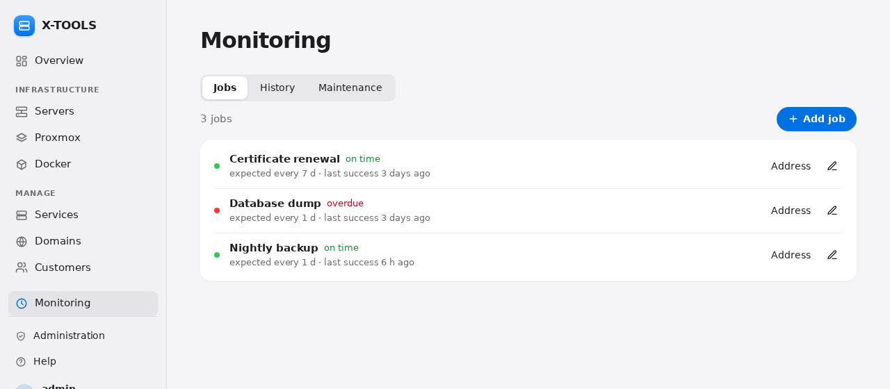

# X-TOOLS

Self-hosted overview of your servers, services and Docker containers – at home or on a VPS – with alerts when
something breaks.

> **Please note: X-TOOLS is entirely “vibe coded”.** The whole project – backend, frontend, installer, documentation –
> was written with an AI assistant (Claude) under the direction of one person, not by a team of engineers.
> It has tests and a security design ([architecture.md](docs/architecture.md#security)), but **no independent code
> review or security audit**. Read the code before you trust it, make backups, and think twice before exposing it to
> the internet or giving it control (Docker socket, Proxmox, root agents) over systems you care about. Use at your own risk.
>
> **Status: beta (1.0.0-beta.3).** All areas are in place; expect rough edges until the final 1.0.0.
> Beta testers: [checklist](docs/beta-testing.md) – tick it in the browser ([beta-checklist.html](docs/beta-checklist.html))
> or in an issue from the template *Beta test*. What changed: [CHANGELOG](CHANGELOG.md).



<table>
<tr>
<td width="50%"><br><sub>Docker – containers, compose files, logs, start/stop</sub></td>
<td width="50%"><br><sub>Servers – list with free groups and tags; a page with tabs per server</sub></td>
</tr>
<tr>
<td><br><sub>Proxmox – LXCs and VMs</sub></td>
<td><br><sub>Customers – website checks, deploy from git</sub></td>
</tr>
<tr>
<td><br><sub>Dark mode</sub></td>
<td><br><sub>Jobs – cron jobs and backups report in</sub></td>
</tr>
</table>

*(Demo data. Screenshots are generated by `docs/screenshots/`.)*

## Features

| Area | What you get |
|---|---|
| **Overview** | Everything that needs attention on one page, recent events, the state of this server |
| **Services** | What runs where: host, ports (checked every minute), domains, folder, uptime; credentials encrypted |
| **Assistant** | New services from templates – compose file, `.env`, proxy/tunnel config and a setup checklist |
| **Servers** | Any Linux server with an agent: a list with your own groups and tags, and a page with tabs per server – load, memory, disks, systemd services (failed ones raise an alert), open ports, pending updates, users and SSH keys, ufw firewall; optional restart, reboot, installing updates |
| **Docker** | All Docker hosts on one page: containers per compose project, start/stop/restart, logs, compose files (secrets masked), host metrics and charts |
| **Proxmox** | Nodes, storage, host network, updates; every LXC/VM with resources, network, IPs, snapshots, backups and its `.conf` file |
| **Agents** | More servers: Linux servers, Proxmox hosts (nodes, LXCs, VMs) and Docker hosts – one install command, outbound only, optional control (start/stop) |
| **Cloudflare** | DNS, tunnels, routes and Access apps, checked against your services; optionally edit DNS records and tunnel routes |
| **Customers** | Optional: contacts, agreements, external website checks – and deploying their websites from git |
| **Notifications** | Telegram and ntfy, with delay and "back to normal"; pause alerts during maintenance |
| **Jobs** | Heartbeat monitors: cron jobs and backups report in, silence raises an alert |
| **Users** | Roles (viewer, operator, admin), two-factor login, audit log, encrypted backups (also automatic) |

## Quick start

Requirements: a Linux VM, LXC or VPS (Debian/Ubuntu) with internet access – **not the Proxmox host itself** (there only
the agent goes). Docker is installed by the installer if missing.

```sh
curl -fsSL https://raw.githubusercontent.com/xarxfy/x-tools/main/install.sh | sudo bash
```

The installer checks Docker (and offers to install it), asks how you reach X-TOOLS (own domain with automatic HTTPS,
behind your own proxy/tunnel, or only in the LAN), builds and starts everything and prints the setup code.
Afterwards: `sudo x-tools-ctl update | status | logs | uninstall`. Prefer to do it by hand?
[installation.md](docs/installation.md#manual-install).

X-TOOLS listens on `127.0.0.1:8080`. Make it reachable, open it and enter the setup code from the log
(`sudo docker logs x-tools`).

| Your situation | How |
|---|---|
| VPS with own domain | Caddy or nginx in front → [installation.md](docs/installation.md#making-it-reachable) |
| Domain at Cloudflare, no open ports | Cloudflare Tunnel → [installation.md](docs/installation.md#c-cloudflare-tunnel) |
| Only at home, nothing public | LAN mode, agents on Proxmox and LXCs → [installation.md](docs/installation.md#homelab-only-no-vps-nothing-public) |
| Just for me, no proxy | SSH tunnel or VPN → [installation.md](docs/installation.md#d-private-only-vpn-or-ssh) |

Update: `sudo x-tools-ctl update` · Backup: *Administration → Backup* · Remove: `curl -fsSL https://raw.githubusercontent.com/xarxfy/x-tools/main/uninstall.sh | sudo bash`

## Documentation

- [How it works & Cloudflare](docs/guide.md) – the parts, first steps, what to do behind Cloudflare Access/Tunnel
- [Installation](docs/installation.md) – install, reachability options, homelab, update, backup, uninstall
- [Agents](docs/agents.md) – Linux, Proxmox and Docker hosts, Proxmox token, Cloudflare Access, troubleshooting
- [Cloudflare](docs/cloudflare.md) – token permissions and what is checked
- [Configuration](docs/configuration.md) – all `XT_*` variables
- [Architecture & security](docs/architecture.md) – how the pieces fit and how data is protected
- [Development](docs/development.md)
- [Beta testing checklist](docs/beta-testing.md) · [interactive version](docs/beta-checklist.html)
- [Wiki](https://github.com/xarxfy/x-tools/wiki) – the same documents as web pages (generated from `docs/`)
- [Changelog](CHANGELOG.md)

The *Help* page inside X-TOOLS explains every area as well.

## Security in short

- The web UI never accesses Docker; a separate collector without network does, and only start/stop/restart/logs.
- Credentials and tokens are encrypted; passwords in compose files and logs are masked; `.env` files are never read.
- Setup code for the first account, two-factor login, roles enforced by the API, audit log.
- Agents open no ports; controlling them is opt-in on the agent and limited to start/stop/restart/logs.

Details: [architecture.md](docs/architecture.md#security)

## Contributing and security

[CONTRIBUTING.md](CONTRIBUTING.md) · report vulnerabilities privately, see [SECURITY.md](SECURITY.md).

## License

[MIT](LICENSE)
